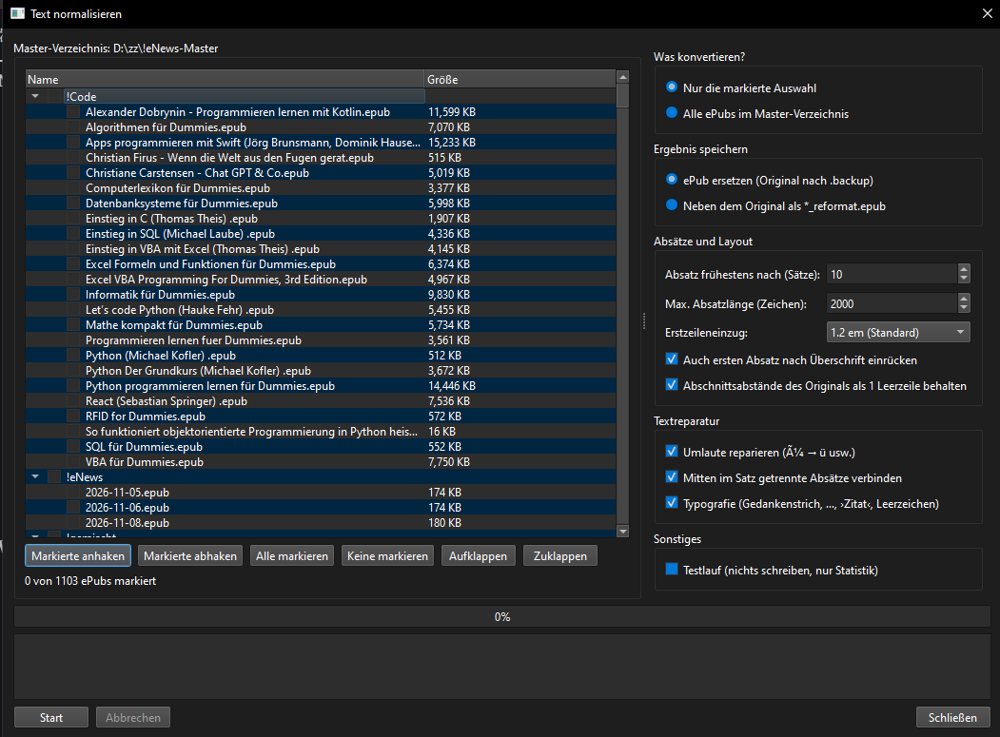
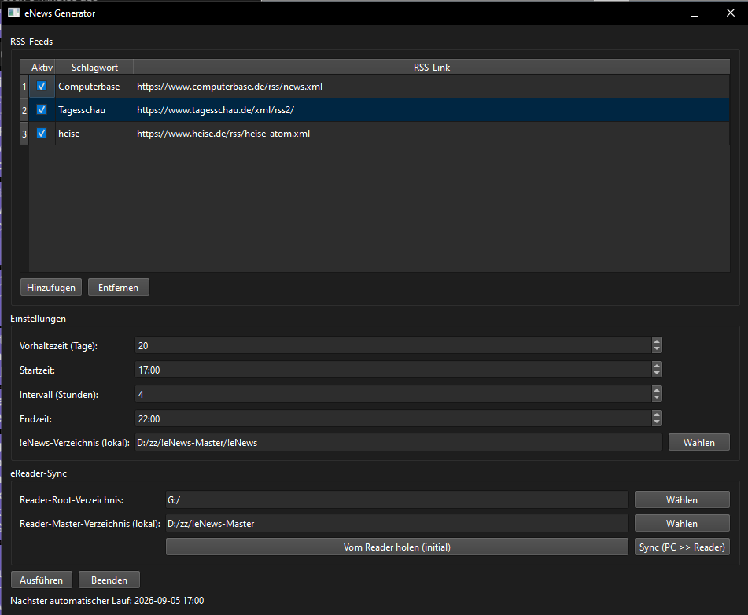

# eNews-eBooks

A compact tool for Windows that allows generating ePub files from RSS feeds. Additionally, it provides complete eReader synchronization and a text normalizer that cleans up badly structured ePubs. The special feature is that initially a complete copy of the eReader is pulled to the PC. Afterwards, this directory serves as the master. This means you only work with this directory. If you want to delete eBooks, you delete them from the PC directory. If you want new ones on the reader, you copy them to the PC directory as well. During "Sync", the eReader becomes a "mirror" of the PC directory – just like Dropbox.


---

**Note:** This program was completely written by Perplexity AI. I only guided it through the process.

This is intended to be a community project. I suspect I will not (or have no) time to add new features or fix bugs. Feel free to add your own changes, fixes, or new features.

**Development Goal:** I have an XTEink X4 Pro eBook reader that I'm very happy with. What I was missing was the ability to read eNews on it. The idea arose to convert RSS feeds into eBooks to read them on the reader. Once this worked, it quickly became clear that handling the files was somewhat cumbersome, and so idea 2 followed: Synchronization of the complete reader with the PC, including the generated eNews ePubs. Idea 3 came from daily use: many ePubs have a terrible text structure (endless empty lines, paragraphs in the middle of a sentence, broken umlauts). The **Text Normalizer** repairs this directly in the master directory.

I hope you like it!

– Dietmar Bos

---

## Features

### Main Features

- **RSS Feed Manager:** Manage unlimited RSS feeds with individual keywords
- **Automatic ePub Generation:** Creates daily new eBooks from your RSS feeds
  - One chapter per feed
  - Detailed table of contents with links to each article
  - "Back to table of contents" link after each chapter
- **Time Scheduling:** Automatic execution at configurable times (start, end, interval)
- **Directory Cleanup:** Keep only the last N days (configurable)
- **eReader Sync:** Complete synchronization between PC and eReader
  - PC as master, reader as mirror
  - Initial pull from reader (complete root directory)
  - Sync (PC → reader)
  - Hidden files and directories (names starting with `.`, e.g. `.crosspoint`, `.backup`) and system directories are never synchronized
  - No synchronization of JSON files (only .epub from !eNews)
  - Optional: delete the CrossPoint reading cache of changed ePubs (see below)
- **Text Normalizer (new):** Repairs the text structure of existing ePubs in the master directory
  - Removes empty blocks and unwanted line breaks
  - Merges paragraphs that were split in the middle of a sentence
  - Collects running text into paragraphs of a minimum number of sentences (dialogue is kept line by line)
  - Repairs broken umlauts (`Früher` → `Früher`)
  - Uniform, minimal stylesheet (indent, no extra gaps)
  - Original is saved to `.backup` before replacing

### Additional Features

- **JSON Configuration:** All settings saved in `config.json`
- **Status Display:** Real-time feedback during copy/sync
- **Exclude List:** System directories are automatically skipped
- **No Encryption:** No external dependencies except PySide6 for the program itself. The text normalizer uses the Python standard library only.

---

## Installation

### Requirements

- Windows 10/11
- Python 3.9 or higher

### Install Dependencies

```bash
python -m pip install PySide6 feedparser beautifulsoup4 lxml requests
```

### Start Program

```bash
python enews_gui.py
```

All `.py` files of the project must be in the same directory (`enews_gui.py`, `rss_worker.py`, `epub_builder.py`, `sync_worker.py`, `pdf_converter.py`, `epub_normalizer.py`, `normalize_dialog.py`).

### Compile as .exe (optional)

```bash
pip install pyinstaller
pyinstaller --onefile --windowed --hidden-import epub_normalizer enews_gui.py
```

You'll find the .exe in the `dist` directory. The `--hidden-import epub_normalizer` is needed because `sync_worker.py` loads this module only at runtime.

---

## Usage

### First Start

1. **Add RSS Feeds:**
   - Click "Hinzufugen" (Add) in the RSS feeds table
   - Enter a keyword (e.g., "Heise") and the RSS URL
   - Repeat for additional feeds

2. **Adjust Settings:**
   - Retention days: How many days should be kept in the !eNews directory? (0 = all)
   - Start time, interval, end time: When should the tool run automatically?
   - !eNews directory: Where should generated files be stored?

3. **Set Up eReader Sync:**
   - Reader root directory: Path to eReader (e.g., `E:\`)
   - Reader master directory: Local directory for synchronization
   - Click "Vom Reader holen (initial)" to completely copy the reader

4. **First Execution:**
   - Click "Ausfuhren" (Execute) to load RSS feeds and create ePub
   - Files are saved in the !eNews directory (as JSON and ePub)

5. **Sync to Reader:**
   - Click "Sync (PC → Reader)" to update the reader

### Normalize Text of Existing ePubs



1. Make sure the **Reader master directory** is set (the dialog works on this directory).
2. Click **"Text normalisieren …"** in the eReader-Sync group.
3. Mark what to convert in the tree. A checked folder includes all ePubs below it (even when collapsed). Use Shift/Ctrl for multiple rows and "Markierte anhaken" / "Markierte abhaken" to check or uncheck all selected rows. Alternatively choose "Alle ePubs im Master-Verzeichnis".
4. Choose the options (see table below). A **test run** shows the statistics without writing anything.
5. Click **Start**. The conversion runs in the background; progress and a per-book log are shown. It can be cancelled at any time.
6. Run **Sync (PC → Reader)** afterwards. Enable "Lese-Cache geänderter ePubs auf dem Reader löschen" if you use CrossPoint firmware (see below).

The first run should be a test run, followed by one book in `_reformat` mode.

#### Options of the Dialog

| Option | Description |
|--------|-------------|
| Nur Auswahl / Alle ePubs | Convert the marked entries or every ePub in the master directory |
| ePub ersetzen | The ePub is replaced; the first original is copied once to `<master>/.backup/<same relative path>`. An existing backup is never overwritten. |
| `*_reformat.epub` | The result is saved next to the original; the original stays untouched |
| Absatz frühestens nach (Sätze) | Running text is collected until at least N sentences are reached (default 10, 1 = keep original paragraphs). Dialogue lines, headings, scene breaks and original section gaps always break. |
| Max. Absatzlänge (Zeichen) | Upper limit (default 2000) so that no walls of text appear. Increase it together with a very high sentence count. |
| Erstzeileneinzug | No indent, 1.0, 1.2 (default) or 1.5 em |
| Ersten Absatz einrücken | Also indent the first paragraph after a heading |
| Abschnittsabstände behalten | Keep large gaps from the original as exactly one empty line (ignored automatically if more than 30 % of the paragraphs have one) |
| Umlaute reparieren | Repairs UTF-8 text that was read as Windows-1252 (`ü` → `ü`, `ß` → `ß`, `–` → `–`) |
| Satzumbrüche verbinden | Joins blocks that end in the middle of a sentence |
| Typografie | `-` → `–`, `...` → `…`, `>Word<` → `›Word‹`, removes spaces before punctuation, soft hyphens and ligatures |
| Testlauf | Nothing is written; only statistics are shown |

All dialog settings are stored in `config.json` under `normalize`.

#### What the Normalizer Does

An ePub is a ZIP file. The normalizer reads `META-INF/container.xml`, finds the `.opf` file and processes every XHTML document of the manifest (not only a folder called `text`). For each document it

1. extracts the text blocks (`div`, `p`, `h1`–`h6` …) and drops empty ones (`&nbsp;`, `<br/>` only),
2. repairs characters and typography,
3. detects headings (heading tags, or short, bold, unpunctuated blocks, resolved from the book's own CSS),
4. joins blocks that end without sentence punctuation (German continuations often start with a capital letter, so case is ignored),
5. regroups running text by the minimum sentence count,
6. writes clean XHTML (`<h1>/<h2>`, `<p>`, `<strong>`, `<em>`) that links to a small stylesheet `enb_normalized.css` added to the ePub.

The ePub is written to a temporary file, verified (ZIP test and XML parsing of every changed document) and only then moved into place. `mimetype` is stored first and uncompressed.

**Skipped automatically:** DRM-protected ePubs (`encryption.xml`), fixed-layout ePubs, ePubs that were already normalized, cover/image-only pages, and documents with tables, lists or SVG (these chapters stay unchanged).

#### Notes on Reading Progress and CrossPoint

- Converting changes the internal structure of a book, so reading progress and bookmarks are gone. The book starts from the beginning.
- If you use the CrossPoint firmware, the reader keeps a cache per book in `.crosspoint/epub_<ID>`. The ID is a 32-bit hash of the book's path, so a replaced ePub at the same path would otherwise be shown with the old cache. With **"Lese-Cache geänderter ePubs auf dem Reader löschen"** the sync removes exactly the cache folders of updated or deleted ePubs. All other caches, settings and Wi-Fi data in `.crosspoint` stay untouched.
- CrossPoint's setting **"Extra Paragraph Spacing"** adds an empty line between all paragraphs. For the cleanest result either turn it off (the first-line indent then marks paragraphs) or set the indent in the dialog to "kein Einzug". Hyphenation in the reader settings further smooths justified text.
- Tested with an XTEink X4 Pro (CrossPoint firmware) and checked against Icecream eBook Reader on the PC. Other readers are untested.

#### Command Line (without GUI)

`epub_normalizer.py` is independent of the GUI:

```bash
python epub_normalizer.py book.epub book_clean.epub --min-sentences 10 --indent 1.2em
python epub_normalizer.py chapter.xhtml out.xhtml --css book.css
```

---

## Configuration

Settings are saved in `config.json`. This file can also be edited manually.

### Example Configuration

```json
{
  "feeds": [
    {
      "enabled": true,
      "keyword": "Computerbase",
      "url": "https://www.computerbase.de/rss/news.xml"
    },
    {
      "enabled": true,
      "keyword": "Tagesschau",
      "url": "https://www.tagesschau.de/xml/rss2/"
    },
    {
      "enabled": true,
      "keyword": "heise",
      "url": "https://www.heise.de/rss/heise-atom.xml"
    }
  ],
  "retention_days": 20,
  "start_time": "17:00",
  "interval_hours": 4,
  "end_time": "22:00",
  "enews_dir": "D:/zz/!eNews-Master/!eNews",
  "reader_root": "G:/",
  "reader_master_dir": "D:/zz/!eNews-Master",
  "purge_cache": false,
  "normalize": {
    "scope": "selection",
    "mode": "replace",
    "min_sentences": 10,
    "max_chars": 2000,
    "indent": "1.2em",
    "indent_first": true,
    "keep_gaps": true,
    "fix_mojibake": true,
    "merge_broken": true,
    "typography": true,
    "dry_run": false
  }
}
```

### Configuration Options

| Field | Description |
|-------|-------------|
| `feeds` | List of RSS feeds (enabled, keyword, url) |
| `retention_days` | How many days to keep in !eNews directory (0 = all) |
| `start_time` | Start time for automatic execution (HH:MM) |
| `interval_hours` | Interval between executions (in hours) |
| `end_time` | End time for automatic execution (HH:MM) |
| `enews_dir` | Local directory for generated files |
| `reader_root` | Root directory of eReader (e.g., `E:\`) |
| `reader_master_dir` | Local master directory for sync (also used by the text normalizer) |
| `convert_pdf_to_epub` | Convert PDFs in the master directory to ePub before sync |
| `purge_cache` | Delete the CrossPoint reading cache of updated/deleted ePubs during sync |
| `normalize` | Settings of the "Text normalisieren" dialog (see table above) |

---

## Screenshots

### Main View



### In-Action (ePub on Reader)


---

## Technical Details

### Dependencies

- **PySide6** – GUI framework
- **feedparser** – RSS/Atom parsing
- **beautifulsoup4** + **lxml** – HTML-to-text conversion
- **requests** – Robust HTTP download for feeds
- The text normalizer needs **no** additional libraries (`zipfile`, `html.parser`, `re`, `xml.etree` from the standard library)

### Architecture

- **enews_gui.py** – Main GUI with timer, RSS download, ePub generation, sync
- **rss_worker.py** – RSS download with fallback logic (lxml repair)
- **epub_builder.py** – Minimal ePub builder (no external libraries)
- **sync_worker.py** – Sync logic (pull/sync with exclude list, optional CrossPoint cache cleanup)
- **epub_normalizer.py** – Pure logic of the text normalizer (no GUI), also usable from the command line
- **normalize_dialog.py** – "Text normalisieren" dialog (tree view, options, background thread)

### ePub Structure

The generated ePub contains:

- Cover page with title and date
- Detailed table of contents with links to each article
- One chapter per feed with keyword as heading
- Per article: title, date, link, content as plain text
- "Back to table of contents" link after each chapter

---

## Frequently Asked Questions

### Q: Why is my config.json not loaded?

A: Make sure the `config.json` is in the same directory as the .exe. It is automatically loaded on startup.

### Q: Which directories are not synchronized?

A: Excluded are: "System Volume Information", ".DS_Store", ".crosspoint", "$RECYCLE.BIN", "Thumbs.db", "desktop.ini" and every file or directory whose name starts with a dot (e.g. `.backup`).

### Q: Why are JSON files not synchronized?

A: JSON files are only relevant for generation and should not be on the reader.

### Q: Can I use the tool without an eReader?

A: Yes! You can use it only for RSS-to-ePub generation. Sync is optional.

### Q: Where is my original after "Text normalisieren"?

A: In `<master>/.backup/` with the same relative path. The first original is kept; later conversions never overwrite it. To go back, copy it over the converted file and sync again.

### Q: The tool says "Bereits normalisiert" for a book.

A: The ePub already contains `enb_normalized.css` and is skipped. Restore the original from `.backup` to convert it again with other settings.

### Q: A converted book still shows too many paragraphs.

A: Raise "Absatz frühestens nach (Sätze)" together with "Max. Absatzlänge", and disable "Abschnittsabstände behalten". Dialogue lines (starting with `»`, `„`, `"`, `–` …) always form their own paragraph. If your reader has an "extra paragraph spacing" option, try turning it off.

### Q: The book on the reader looks like before the conversion.

A: Most likely the reader still uses its old cache. Enable "Lese-Cache geänderter ePubs auf dem Reader löschen" for the sync, or clear the reading cache in the reader settings.

---

## Credits

Developed with help from **Perplexity AI**. This project shows how AI-assisted development can create practical tools for everyday use.

---

## License

MIT License – See [LICENSE](LICENSE) file.

---

## Support

This is a community project. For questions or problems:

- Open an issue on GitHub
- Describe your problem as detailed as possible
- I'll try to help, but can't give any guarantee

**Note:** This project was developed with help from AI (Perplexity AI).

---

## Changelog

### Version 1.1 (November 2026)

- New: **Text Normalizer** ("Text normalisieren …" button) with tree selection, test run, background processing and progress log
- New: paragraph regrouping by minimum sentence count, repair of broken umlauts, typography cleanup, uniform stylesheet
- New: originals are saved to `.backup` in the master directory (or `*_reformat.epub` next to the original)
- New: optional deletion of the CrossPoint reading cache of changed ePubs during sync
- New: `epub_normalizer.py` can be used on the command line
- Sync: all hidden entries (names starting with `.`) are excluded, including `.backup`

### Version 1.0 (September 2026)

- Initial release
- RSS feed manager with automatic ePub generation
- Time scheduling (start/end/interval)
- Directory cleanup (retention days)
- eReader sync (PC as master, reader as mirror)
- Exclude list for system directories
- Warning before sync if master directory is empty
- Status display during copy/sync
